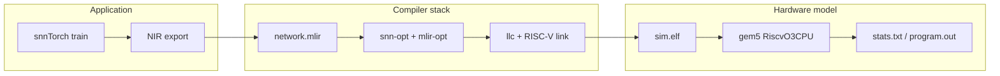
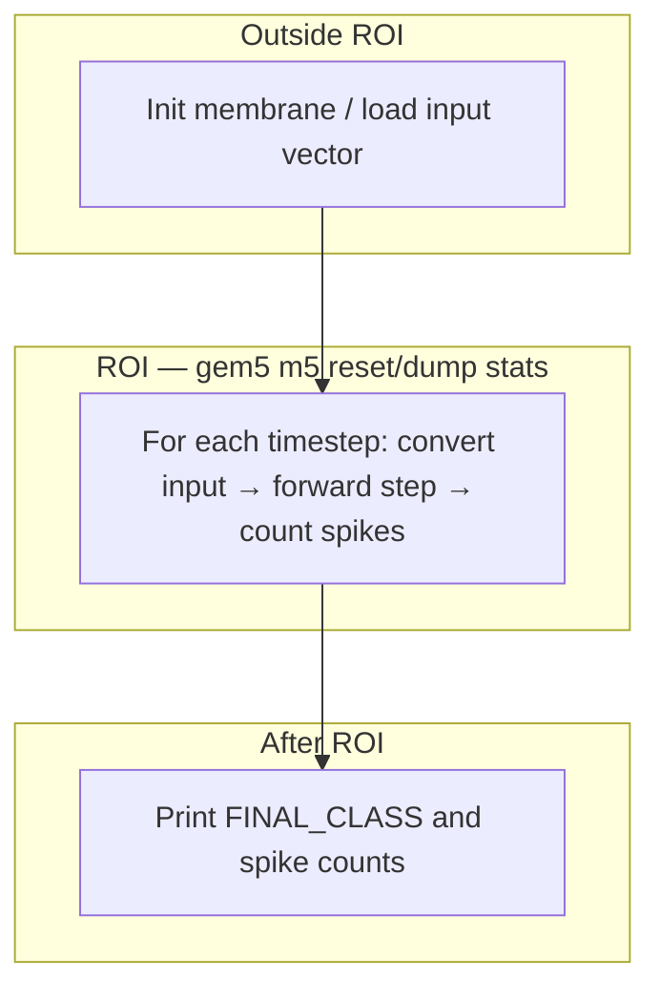
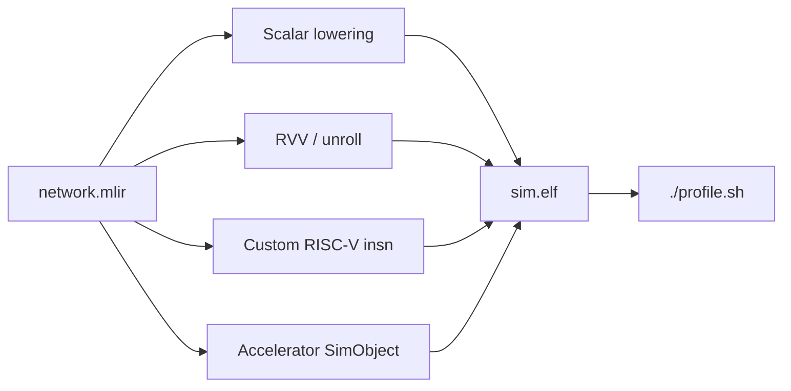

# Stratum (Research-Work)

Hardware–software co-design workspace for **N-MNIST** spiking networks: train in **snnTorch**, lower through **NIR / snn-mlir**, link a **bare-metal RV32** binary (`sim.elf`), and evaluate on **gem5** (`RiscvO3CPU`) inside a defined **region of interest (ROI)**.

---

## Table of contents

1. [Overview](#overview)
2. [Prerequisites](#prerequisites)
   - [Host packages](#host-packages)
   - [Toolchain layout](#toolchain-layout)
   - [What is not in git](#what-is-not-in-git)
3. [First-time setup](#first-time-setup)
   - [Clone and environment](#clone-and-environment)
   - [Build gem5](#build-gem5)
   - [Build snn-opt and MLIR](#build-snn-opt-and-mlir)
   - [Prepare N-MNIST and sim.elf](#prepare-n-mnist-and-simelf)
4. [Quick start](#quick-start)
5. [End-to-end pipeline](#end-to-end-pipeline)
6. [ROI, stats, and correctness](#roi-stats-and-correctness)
7. [Commands reference](#commands-reference)
   - [profile.sh modes](#profilesh-modes)
   - [run.sh and gem5 knobs](#runsh-and-gem5-knobs)
   - [snnMNIST Makefile variables](#snnmnist-makefile-variables)
8. [Repository layout](#repository-layout)
9. [Further reading](#further-reading)
10. [Paper reproduction](#paper-reproduction)
11. [Co-design: where to change things](#co-design-where-to-change-things)
12. [Reference numbers](#reference-numbers)
13. [Troubleshooting](#troubleshooting)

---

## Overview

Stratum connects three layers:

| Layer | Directory | Role |
| --- | --- | --- |
| Application | `snnMNIST/` | Model, training, input spikes, generated `main.c` |
| Compiler | `snn-mlir/` | `snn-opt`, SNN dialect → Linalg → LLVM |
| Simulator | `gem5/` | Cycle-level RV32, caches, ROI statistics |

**Default model (ISCAS case study):** f32 two-layer SNN, **skip-zeros** lowering, **2312** inputs, **256** hidden units, **10** classes.

| Setting | Typical value | Notes |
| --- | --- | --- |
| Timesteps (`--n-steps`) | **25** | Default in `run.py`; fast `./profile.sh` runs |
| Paper / Step 0 ROI | **300** | Set `N_STEPS=300` when building `sim.elf` |
| Layout A (reference) | `k-major=false` | Output-outer loop order |
| Layout B (production) | `k-major=true` | Spike-major / skip-zeros friendly order |
| Quantization | `QUANTIZE=0` (profile default) | `QUANTIZE=1` for int8 Q12 path |

---

## Prerequisites

### Host packages

- **Linux** (Ubuntu 22.04+ tested)
- **Python 3.12+** with venv support
- **LLVM 18** on PATH: `llc`, `mlir-opt`, `mlir-translate`, `ld.lld` (see [setup.sh](setup.sh))
- **RISC-V embedded GCC**: `riscv32-unknown-elf-gcc` (default prefix `~/RISCV/riscv`)
- **gem5 build deps**: scons, protobuf, etc. ([gem5 documentation](https://www.gem5.org/documentation/general_docs/building))

### Toolchain layout

After `source setup.sh`, these paths should exist (warnings indicate what to fix):

| Variable | Expected path |
| --- | --- |
| `SNN_OPT` | `snn-mlir/build/bin/snn-opt` |
| `MLIR_DIR` | `snn-mlir/.local/mlir18/.../MLIRConfig.cmake` |
| `LLVM_BIN` | `/usr/bin` (system `llc`) |
| `RISCV` | `~/RISCV/riscv` (or override) |
| `PYTHON` | `snnMNIST/.venv/bin/python` |
| `GEM5_BIN` | `gem5/build/RISCV/gem5.opt` (via [run.sh](run.sh)) |

### What is not in git

Regenerate on each machine (see `.gitignore`):

- `snnMNIST/data/`, `snnMNIST/cache/` — dataset and caches  
- `snnMNIST/build/` — `sim.elf`, MLIR, LLVM IR  
- `gem5/build/` — `gem5.opt`  
- `snn-mlir/build/`, `snn-mlir/.local/` — compiler and MLIR install  
- `results/runs/` — per-experiment gem5 trees (regenerate via `results/run_experiments.py`)  
- `results/plots/` — figures from `results/make_tables.py`

---

## First-time setup

Work through these once before `./profile.sh`.

### Clone and environment

```bash
git clone git@github.com:chaselab-lums/stratum.git
cd stratum   # or your checkout path
source setup.sh
```

Fix any **WARNING** lines from `setup.sh` before continuing.

### Build gem5

From the repo root (see also `gem5/README.md`):

```bash
cd gem5
scons build/RISCV/gem5.opt -j"$(nproc)"
cd ..
```

Confirm: `gem5/build/RISCV/gem5.opt --version` or run `./run.sh` after `sim.elf` exists.

### Build snn-opt and MLIR

1. Install or symlink MLIR 18 under `snn-mlir/.local/mlir18` (as expected by `setup.sh`).
2. Build the SNN dialect:

```bash
cd snn-mlir
bash scripts/build_snn_dialect.sh   # or: make -C build via snnMNIST dependency
cd ..
```

Confirm: `test -x snn-mlir/build/bin/snn-opt`.

### Prepare N-MNIST and sim.elf

```bash
cd snnMNIST
python3 -m venv .venv && .venv/bin/pip install -r requirements.txt
# Dataset: follow snnMNIST/README.md (Tonic N-MNIST download / cache)

make help
make build ENABLE_GEM5_M5OPS=1 BUILD_NO_TRAIN=1
cd ..
```

**Paper-length ROI (300 steps, one test vector, spike-major):**

```bash
cd snnMNIST
SNN_LINALG_OPTS='skip-zeros=true k-major=true' \
  N_STEPS=300 TEST_VECTORS=1 \
  make build NO_TRAIN=1 ENABLE_GEM5_M5OPS=1
cd ..
```

Artifacts: `snnMNIST/build/sim.elf`, `network.mlir`, `program.out` after gem5.

---

## Quick start

With prerequisites satisfied:

```bash
source setup.sh
./profile.sh
```

**Output:** open `gem5/work/results/profiles/report.html` (roofline + L2 sweep).

**Single gem5 run** (no full report pipeline):

```bash
source setup.sh
./run.sh
# stats under gem5/work/results/runs/<timestamp>/...
```

---

## End-to-end pipeline

### Data flow



### Host driver (inside `sim.elf`)



Compiler lowering for `snn.linear` (skip-zeros, spike-major) is documented in [snn-mlir/docs/dialect/lowering-pass.md](snn-mlir/docs/dialect/lowering-pass.md) and [snn-mlir/docs/getting-started/how-it-works.md](snn-mlir/docs/getting-started/how-it-works.md).

---

## ROI, stats, and correctness

**ROI** = all forward timesteps for one input vector (default **25** in `run.py`; **300** for the Stratum paper table). The generated host driver calls gem5 **m5** operations to reset and dump statistics around that loop ([results/GEM5_METHODOLOGY.md](results/GEM5_METHODOLOGY.md)).

**Functional guard:** when comparing compiler or hardware knobs, **`FINAL_CLASS[…]`** and per-class spike counts in `program.out` must match the reference binary. If spikes change, the experiment changed network behavior—not just timing.

**Phase breakdown (optional):** `PHASE_PROFILE=1` and injected `snn_phase_marker` use **`rdcycle`** reads for scan / gather / LIF / fc2 shares; see REPRODUCE Task 1.

---

## Commands reference

### profile.sh modes

Index file: [profile.json](profile.json) → configs under `configs/profile/`.

| Command | Purpose |
| --- | --- |
| `./profile.sh` or `./profile.sh all` | Rebuild `sim.elf`, ROI stats, O3 trace window, L2 sweep → `report.html` |
| `./profile.sh stats` | ROI stats only |
| `./profile.sh o3pipe` | Short O3 pipeline trace |
| `./profile.sh opt-compare` | Compare compiler variants |
| `./profile.sh sweep` | Knob sweep (default: L2 size in `sweep.json`) |

Each mode reuses `ensure_build`: `make -C snnMNIST build ENABLE_GEM5_M5OPS=1 BUILD_NO_TRAIN=1` (25-step default unless you rebuilt with other `N_STEPS`).

### run.sh and gem5 knobs

| Variable | Default | Meaning |
| --- | --- | --- |
| `GEM5_BIN` | `gem5/build/RISCV/gem5.opt` | Simulator binary |
| `GEM5_CPU_TYPE` | `RiscvO3CPU` | CPU model |
| `GEM5_BOOM` | `1` | Wide BOOM-style O3 parameters; `0` = stock gem5 O3 |
| `GEM5_L2_SIZE` | `4MiB` | Last-level cache size |
| `GEM5_MEM_SIZE` | `8GiB` | Physical memory |
| `GEM5_OUTDIR` | under `gem5/work/results` | Override output directory |

Example L2 sweep point:

```bash
GEM5_L2_SIZE=1MiB ./run.sh snnMNIST/build/sim.elf baremetal
```

### snnMNIST Makefile variables

| Variable | Example | Effect |
| --- | --- | --- |
| `SNN_LINALG_OPTS` | `'skip-zeros=true k-major=true'` | Lowering flags to `snn-opt` |
| `N_STEPS` | `300` | Timesteps per inference |
| `TEST_VECTORS` | `1` | Number of drawings in `input.h` |
| `QUANTIZE` | `0` / `1` | f32 vs int8 export |
| `NO_TRAIN` | `1` | Skip training; use `weights.pt` |
| `PHASE_PROFILE` | `1` | Link `phase_marker.c` for stage cycles |
| `ENABLE_GEM5_M5OPS` | `1` | ROI markers in binary |

Full detail: [snnMNIST/README.md](snnMNIST/README.md).

---

## Repository layout

```text
stratum/  (Research-Work)
├── README.md                 ← you are here
├── setup.sh                  source before build/run
├── profile.sh, run.sh        main gem5 entry points
├── profile.json              profile mode index
├── configs/profile/          per-mode gem5 JSON
├── docs/README.md            documentation map
├── snnMNIST/                 model, Makefile, sim.elf build
├── snn-mlir/                 compiler sources + snn-opt
├── gem5/                     simulator + work/results
├── results/                  REPRODUCE scripts, metrics.csv, summary.md
└── scripts/                  gem5 report.html and analysis helpers
```

---

## Further reading

| Document | Use when |
| --- | --- |
| [docs/README.md](docs/README.md) | Index of all user-facing docs |
| [snnMNIST/README.md](snnMNIST/README.md) | Training, export, Makefile, architecture diagram |
| [results/REPRODUCE.md](results/REPRODUCE.md) | Full experiment matrix (Tasks 1–6) |
| [results/GEM5_METHODOLOGY.md](results/GEM5_METHODOLOGY.md) | ROI parsing, cache counters, phase markers |

---

## Paper reproduction

Headline **drawing 0**, `TEST_VECTORS=1`, skip-zeros on both layouts:

| Layout | `SNN_LINALG_OPTS` | ROI time (reference run) |
| --- | --- | ---: |
| Output-outer | `skip-zeros=true k-major=false` | **7.038 ms** |
| Spike-major | `skip-zeros=true k-major=true` | **4.423 ms** |

One-shot script:

```bash
bash results/step0/run_reproduce.sh
```

Full matrix: [results/REPRODUCE.md](results/REPRODUCE.md) → `python3 results/run_experiments.py`, `results/metrics.csv`.

---

## Co-design: where to change things

Same `network.mlir`, same spike check, different implementation:



| Goal | Where to edit |
| --- | --- |
| Architecture, timesteps, quantization | `snnMNIST/train.py`, `run.py` |
| `snn.linear` / skip-zeros / k-major | `snn-mlir/lib/Conversion/SNNToLinalg/` |
| New lowering backend | [snn-mlir/docs/dialect/lowering-pass.md](snn-mlir/docs/dialect/lowering-pass.md) |
| ROI boundaries | Generated `main.c` (gem5 m5 ops) |
| Decode new CPU opcode | `gem5/src/arch/riscv/isa/decoder.isa` |
| Offload engine | New gem5 SimObject + bare-metal config |

Suggested order: keep scalar `sim.elf` as reference → add lowering switch → custom instruction latency sweep → accelerator device.

---

## Reference numbers

### Example commit mix (one timestep, 25-step profile binary)

Simulated **RiscvO3CPU** (not silicon), first full timestep ≈ **5.95M** instructions, IPC ≈ **1.68**:

| Instruction class | Share |
| --- | ---: |
| IntAlu | 50% |
| Loads | 30% |
| Stores | 10% |
| IntMult | 10% |

fc1 dominates (2312×256 updates per step); skip-zeros gathers only **live** spikes (~2.5 active inputs per step on average in the paper trace).

### Roofline in `report.html`

Built by `scripts/gem5_bottleneck_html.py` from one ROI in `stats.txt` plus bandwidth and FU counts from `config.ini` (no extra simulation). IntMult count ≈ MACs; achieved throughput = MACs / region time.

### Sweep configuration

Edit [configs/profile/sweep.json](configs/profile/sweep.json): each point has `name`, `label`, and extra gem5 arguments. `./profile.sh sweep` skips re-run when `stats.txt` and `knob.txt` already match.

---

## Troubleshooting

| Symptom | Likely fix |
| --- | --- |
| `WARNING: snn-opt not found` | Build or copy `snn-mlir/build/bin/snn-opt`; re-run `source setup.sh` |
| `WARNING: MLIRConfig.cmake not found` | Install MLIR 18 under `snn-mlir/.local/mlir18` |
| `riscv32-unknown-elf-gcc: not found` | Install RISC-V toolchain; set `RISCV=` before `setup.sh` |
| gem5 fails immediately | Rebuild `gem5.opt`; check `GEM5_SCRIPT` / bare-metal config in `run.sh` |
| Missing `sim.elf` | `cd snnMNIST && make build ENABLE_GEM5_M5OPS=1` |
| Different class vs reference | Compare `program.out`; do not trust timing-only comparisons |
| Slow first `./profile.sh` | Expected: rebuild + multiple gem5 runs; use `./run.sh` for one shot |

For experiment-specific issues, see [results/REPRODUCE.md](results/REPRODUCE.md) and [results/GEM5_METHODOLOGY.md](results/GEM5_METHODOLOGY.md).
