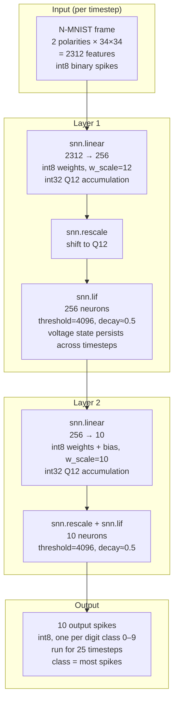

# snnMNIST: N-MNIST Digit Classification on RV32

End-to-end pipeline: train a spiking neural network on N-MNIST, export it through the snn-mlir compiler, and run the quantized int8 inference kernel on a simulated RV32 RISC-V core.

---

## Directory layout

```
snnMNIST/
├── train.py            # Training only. Writes weights.pt
├── run.py              # Load weights, test drawn images, emit NIR and C
├── model.py            # PyTorch/snnTorch model definition
├── _codegen.py         # C runtime file generator (main.c, snn_data.h, input.h)
├── export_nir.py       # NIR graph construction + weight export
├── draw_input_app.py   # GUI: draw a digit → build/input.h
├── lower_cpu_linux.sh  # MLIR → LLVM IR lowering script
├── Makefile            # Build orchestration
├── requirements.txt    # Python dependencies
├── weights.pt          # Saved model checkpoint
├── input.h             # Legacy shim (includes build/input.h)
├── include/
│   ├── crt0.S          # Bare-metal startup for RV32
│   ├── link.ld         # Linker script
│   ├── printf.c        # Minimal printf for bare-metal
│   ├── memutils.c      # Word-aligned memset/memcpy (no RV64 libc)
│   └── defines.h
└── build/              # All generated artifacts (gitignored)
    ├── network.nir     # Neuromorphic Intermediate Representation
    ├── network.mlir    # MLIR dialect IR (snn.linear, snn.lif, …)
    ├── network.ll      # LLVM IR (lowered from MLIR)
    ├── main.c          # Generated C harness
    ├── snn_data.h      # Generated constants (layer sizes, timesteps)
    ├── input.h         # Test input spike vectors
    ├── sim.elf         # RV32 ELF binary
    ├── sim.elf.dis     # Disassembly
    └── sim.elf.hex     # Verilog hex (for RTL simulation)
```

---

## Network architecture

The exported model is a two-layer feedforward SNN trained on N-MNIST:



This runs for **25 timesteps**. Voltage state persists across timesteps; a spike resets voltage to 0.

**Quantization (enabled by default, `QUANTIZE=1`):**

| Tensor | Type | Notes |
|---|---|---|
| Weights w_fc1 | int8 | 256×2312, w_scale=12 |
| Weights w_fc2 | int8 | 10×256, w_scale=10 |
| Input spikes | int8 | binary ±1 |
| Synapse output | int32 | Q12 fixed-point |
| LIF voltage state | int32 | Q12, threshold=4096=2^12 |
| Output spikes | int8 | binary 0 or 1 |

**Total MACs per inference (25 timesteps):**
- Layer 1: 2312 × 256 × 25 = **14.8M MACs**
- Layer 2: 256 × 10 × 25 = 64k MACs

---

## Full compilation pipeline

```
 N-MNIST dataset (Tonic)
        │ tonic.transforms.ToFrame (34×34, 2 polarities)
        ▼
 snnTorch training  (train.py --arch mlir)
        │ nirtorch.to_nir()
        ▼
 build/network.nir       ← Neuromorphic Intermediate Representation
        │ snn_mlir.export(quantize=True)
        ▼
 build/network.mlir      ← snn.linear / snn.lif / snn.rescale ops
        │ lower_cpu_linux.sh
        │   snn-opt  --convert-snn-to-linalg
        │   mlir-opt <affine/scf/func/llvm passes>
        │   mlir-translate --mlir-to-llvmir
        ▼
 build/network.ll        ← LLVM IR (int8/int32 arithmetic, i64 loop counters)
        │ llc -mtriple=riscv32-unknown-elf -mattr=+m,+c,+zicsr
        ▼
 build/network.o         ← RV32 object file
        │
        │ riscv64-unknown-elf-gcc -c  (main.c, printf.c, memutils.c, crt0.S)
        ▼
 build/*.o
        │ ld.lld -m elf32lriscv  -T include/link.ld
        ▼
 build/sim.elf           ← RV32 bare-metal ELF
        │ objdump / objcopy
        ▼
 build/sim.elf.dis       ← Disassembly
 build/sim.elf.hex       ← Verilog hex (load into RTL simulator)
        │ target-specific sim (read_elf or $readmemh)
        ▼
 RTL simulation
```

---

## Prerequisites

### Python packages

```bash
pip install -r requirements.txt
```

Contents: `torch torchvision snntorch tonic nir nirtorch snn-mlir`

### snn-mlir + MLIR tools

Build `snn-opt` and the MLIR/LLVM tools (mlir-opt, mlir-translate):

```bash
cd ../snn-mlir
bash scripts/build_snn_dialect.sh
```

Produces: `snn-mlir/build/bin/snn-opt`

### LLVM with RISC-V backend and lld

The `llvm-project/build` must include the RISC-V target and lld:

```bash
cd ../llvm-project/build
cmake . -DLLVM_TARGETS_TO_BUILD="host;RISCV" -DLLVM_ENABLE_PROJECTS="mlir;lld"
cmake --build . --target llc lld -j$(nproc)
```

Verify:
```bash
$LLVM_BIN/llc --version | grep riscv
$LLVM_BIN/ld.lld --version
```

### RISC-V GCC toolchain (C/assembly compilation only)

`riscv64-unknown-elf-gcc` must be in PATH. Used only for compiling C/S files, not for linking.

### Environment variables

```bash
source /path/to/Research-Work/setup.sh
```

Sets: `SNN_MLIR_ROOT`, `MLIR_DIR`, `LLVM_BIN`, `SNN_OPT`, `RISCV`.

---

## Makefile targets

| Target | What it does |
|---|---|
| `make generate` | Train (or skip), export NIR → MLIR → LLVM IR |
| `make build` | `generate` + link → `build/sim.elf`, `build/sim.elf.hex` |
| `make python-test` | Python-level inference (no C, no RISC-V) |
| `make draw-input` | Launch GUI to draw a digit → `build/input.h` |
| `make clean` | Delete `build/` |

Common overrides:

```bash
make build NO_TRAIN=1          # skip training, reuse weights.pt
make build N_STEPS=10          # 10 timesteps instead of 25
make build QUANTIZE=0          # float32 mode (no int8)
```

`make build` produces `build/sim.elf` and `build/sim.elf.hex` (DRAM @ `0x80000000`, see `include/link.ld`). Run RTL simulation from the CVA6 tree, e.g.:

```bash
source ../../../setup.sh
cd ../../../cva6/verif/sim
make veri-testharness \
  target=cv32a60x \
  elf=$PWD/../../../snnMNIST/build/sim.elf \
  path_var=$PWD/../.. \
  tool_path=$PWD/../../tools/spike/bin \
  issrun_opts="+debug_disable=1 +time_out=50000000" \
  log=sim_snnMNIST.log
```

---

## Step-by-step recreation guide

Follow this in order if you are starting with no background in compilers or SNNs.

### Background concepts (read first)

**SNN — Spiking Neural Network:**
Neurons communicate with binary spikes (0 or 1) over discrete timesteps rather than continuous values. The key neuron model is LIF (Leaky Integrate-and-Fire). This repo’s snnTorch export and `snn-mlir` lowering match **Leaky** with `reset_mechanism="subtract"` and `reset_delay=True`: if the **stored** voltage was above threshold, the **next** step subtracts the threshold before integrating; spikes use strict `>`.

$$\mathrm{sub}_t = (v_{t-1} > \theta) ? \theta : 0 \qquad v_t = \alpha v_{t-1} + I_t - \mathrm{sub}_t \qquad s_t = \begin{cases}1 & v_t > \theta \\ 0 & \text{otherwise}\end{cases}$$

**N-MNIST:**
MNIST digits captured by a neuromorphic (event) camera. Each digit is a stream of (x, y, polarity, time) events. We convert to 25 fixed frames of shape 2×34×34 (ON/OFF channels × height × width).

**NIR — Neuromorphic Intermediate Representation:**
A portable graph format for SNNs, analogous to ONNX for conventional networks. Sits between snnTorch and the snn-mlir compiler.

**MLIR:**
A compiler framework (part of LLVM). `snn-mlir` defines custom ops: `snn.linear`, `snn.lif`, `snn.rescale`. These are progressively lowered to standard ops, then to LLVM IR.

**LLVM IR:**
Low-level, portable assembly-like language. The SNN ops become `mul`, `add`, `icmp`, `select`, `load`, `store` instructions that LLVM compiles to RISC-V machine code.

**Quantization (int8/Q12):**
Weights and activations are stored as int8. Accumulation is done in int32 using Q12 fixed-point (scale factor 2^12 = 4096). This avoids floating-point hardware on the embedded target.

---

### Step 1 — Clone dependencies and set up environment

```bash
# Ensure these repos exist alongside snnMNIST:
#   ../snn-mlir       (snn-mlir compiler)
#   ../llvm-project   (LLVM 24.x)

source ../setup.sh
cd snnMNIST
pip install -r requirements.txt
```

---

### Step 2 — Build snn-opt

`snn-opt` understands `snn.*` MLIR ops and converts them to standard linalg/affine:

```bash
cd ../snn-mlir
bash scripts/build_snn_dialect.sh
# Result: snn-mlir/build/bin/snn-opt
```

---

### Step 3 — Build llc and ld.lld with RISC-V support

```bash
cd ../llvm-project/build
cmake . -DLLVM_TARGETS_TO_BUILD="host;RISCV" -DLLVM_ENABLE_PROJECTS="mlir;lld"
cmake --build . --target llc lld -j$(nproc)
# Verify:
./bin/llc --version | grep riscv   # must show riscv32 / riscv64
./bin/ld.lld --version
```

---

### Step 4 — Train and generate all intermediate files

```bash
cd ../snnMNIST
source ../setup.sh
make generate
```

What happens:
1. Downloads N-MNIST via Tonic into `data/` (first run only, ~260 MB)
2. Preprocesses frames into `cache/` (first run only, ~360 MB)
3. Trains the 2-layer SNN on N-MNIST for the configured number of epochs
4. Saves `weights.pt`
5. Exports `build/network.nir` (direct NIR from `run.py` for the MLIR arch)
6. Runs `snn_mlir.export(quantize=<QUANTIZE>)` → `build/network.mlir` (default **float**; pass `QUANTIZE=1` for int8)
7. Runs `lower_cpu_linux.sh` → `build/network.ll`

After training once, skip it on subsequent runs:
```bash
make generate NO_TRAIN=1
```

---

### Step 5 — Read the intermediate representations

**`build/network.mlir`** — human-readable semantic ops:
```mlir
snn.linear ins(%input, %w_fc1) out(%synapse_fc1) {w_scale = 12 : i64}
    : memref<2312xi8>, memref<256x2312xi8> -> memref<256xi32>

snn.rescale ins(%synapse_fc1) out(%rescaled_fc1) {w_scale = 12, d_scale = 12}
    : memref<256xi32> -> memref<256xi32>

snn.lif ins(%rescaled_fc1) state(%voltage_lif1) out(%spikes_lif1)
    {threshold_int = 4096, decay_int = 2048}
    : memref<256xi32>, memref<256xi32> -> memref<256xi8>
```

**`build/network.ll`** — the same ops as LLVM IR arithmetic:
```llvm
; inner MAC loop body (simplified):
%w  = load i8,  ptr @w_fc1           ; int8 weight
%x  = load i8,  ptr %input_ptr       ; int8 input spike
%wx = sext i8 %w to i32
%p  = mul i32 %wx, %scale_constant   ; fixed-point multiply
%a  = add i32 %acc, %p               ; accumulate into int32

; LIF update (delayed subtract reset — matches snnTorch / LowerLIF):
%v_prev = load i32, ptr %voltage_state
%th     = ...                        ; threshold in Q12 (4096 = 2^12)
%prev_sp = icmp sgt i32 %v_prev, %th ; did we fire last step?
%sub    = select i1 %prev_sp, i32 %th, i32 0
%dv     = mul i32 %v_prev, 2048      ; decay multiply (decay_int >> d_scale)
%dv_q12 = ashr i32 %dv, 12
%v_int  = add i32 %dv_q12, %input
%v_new  = sub i32 %v_int, %sub       ; integrate, then subtract threshold if needed
%spike  = icmp sgt i32 %v_new, %th
; store %v_new back to voltage_state (not hard reset to 0 on spike)
```

**`build/main.c`** — generated C harness: feeds inputs to the kernel each of the 25 timesteps and reads output spikes.

---

### Step 6 — Build the RV32 binary

```bash
make build NO_TRAIN=1
```

Compile and link order:
1. `llc` → `build/network.o` (LLVM IR to RV32 object)
2. `riscv64-unknown-elf-gcc -c` → `build/crt0.o`, `printf.o`, `memutils.o`, `main.o`
3. `ld.lld -m elf32lriscv` → `build/sim.elf`
4. `objdump` → `build/sim.elf.dis`
5. `objcopy` → `build/sim.elf.hex`

---

### Step 7 — Verify with Python inference

Before running on hardware, check that the model predicts correctly in Python:

```bash
make python-test NO_TRAIN=1
```

This runs the full forward pass in PyTorch/snnTorch, prints per-timestep spikes, and shows the predicted class. No compiler or RISC-V involved.

---

### Step 8 — Provide a custom test input (optional)

Test images come from the drawing app. Draw five digits:

```bash
make draw-input
```

A GUI opens. Draw a digit, click Save, and the canvas clears. Do that five times. This writes `build/input.h` and `build/input_0.h` through `build/input_4.h`. Then:

```bash
make build NO_TRAIN=1
```

**Draw app controls:**

| Control | Effect |
|---|---|
| Emit steps | Which timesteps get events (e.g. 0–8) |
| Saccade amp | Pixel shift between frames (motion realism) |
| Noise ppm | Random event rate (0 = none) |
| Max evt/step | Cap total events per timestep (prevents saturation) |

Good starting values: emit steps 0–8, saccade amp 1, noise ppm 0, max evt/step 120.

---

## Performance on RV32

| Metric | Value |
|---|---|
| Timesteps | 25 |
| Layer 1 MACs | 2312 × 256 × 25 = 14.8M |
| Layer 2 MACs | 256 × 10 × 25 = 64k |
| Inner loop cost | ~14 instructions/MAC (incl. i64 counter emulation) |
| memset/memcpy | 4-byte word-aligned (`include/memutils.c`) |

**To reduce cycle count:**

```bash
make build N_STEPS=10           # 2.5× fewer MACs
```

Or reduce the model (requires retraining): change `256` → `128` hidden neurons in `train.py`, or change the tonic frame resolution from 34×34 to 16×16 (~4.5× fewer MACs in layer 1).

The i64 loop counter overhead (~30% of inner loop) requires `finalize-memref-to-llvm=index-bitwidth=32` in `lower_cpu_linux.sh`, which currently has a type mismatch with the memref struct ABI.

---

## Toolchain summary

| Tool | Role | Source |
|---|---|---|
| `snn-opt` | `snn.*` ops → linalg MLIR | snn-mlir/build/bin |
| `mlir-opt` | Linalg → affine → SCF → LLVM dialect | llvm-project/build/bin |
| `mlir-translate` | LLVM dialect → LLVM IR text (.ll) | llvm-project/build/bin |
| `llc` | LLVM IR → RV32 object (needs RISC-V backend) | llvm-project/build/bin |
| `ld.lld` | RV32 linker | llvm-project/build/bin |
| `riscv64-unknown-elf-gcc` | C/S files → RV32 objects | RISC-V GCC toolchain |
| `riscv64-unknown-elf-objdump` | ELF → disassembly | RISC-V GCC toolchain |
| `riscv64-unknown-elf-objcopy` | ELF → Verilog hex | RISC-V GCC toolchain |

---

## Files you will usually change

| File | Why |
|---|---|
| `train.py` | Change model architecture, training hyperparameters, input resolution |
| `model.py` | Change layer sizes or neuron model |
| `_codegen.py` | Change generated `main.c` structure or output format |
| `draw_input_app.py` | Change event synthesis parameters |
| `lower_cpu_linux.sh` | Change MLIR lowering passes |
| `Makefile` | Change build flags, default N_STEPS, target arch |

---

## Learning MLIR

Start with these in order.

**1. Understand what problem MLIR solves (30 min)**  
https://mlir.llvm.org/docs/Rationale/Rationale/  
Key insight: MLIR lets you define your own intermediate representations ("dialects") and compose compiler passes across them. `snn-mlir` is exactly that — it defines the `snn` dialect.

**2. Official Getting Started (1–2 hours)**  
https://mlir.llvm.org/getting_started/
  
Focus on: what a dialect is, what an op is, what a pass is.

**3. The Toy Tutorial — the canonical learning path (half a day)**  
https://mlir.llvm.org/docs/Tutorials/Toy/  
Chapters 1–4 are directly relevant:

| Chapter | What it covers | Maps to this project |
|---|---|---|
| Ch1 | Define a dialect and ops | `snn.linear`, `snn.lif` in `SNNOps.td` |
| Ch2 | Add type verification | op shape/type constraints in `snn-mlir` |
| Ch3 | Write a transformation pass | any pass in `lower_cpu_linux.sh` |
| Ch4 | Lower to another dialect | `SNNToLinalg.cpp` |

**4. Then read the snn-mlir source with fresh eyes**

| File | What it shows |
|---|---|
| `snn-mlir/include/SNN/SNNOps.td` | `snn.linear` and `snn.lif` declared using TableGen |
| `snn-mlir/lib/Conversion/SNNToLinalg/SNNToLinalg.cpp` | the lowering pass (Chapter 4 applied) |
| `snnMNIST/lower_cpu_linux.sh` | the full pass pipeline from `snn` to LLVM IR |
| `snnMNIST/build/network.mlir` | your actual network as MLIR ops |

**5. Reference pages to bookmark**
- Builtin types: https://mlir.llvm.org/docs/Dialects/Builtin/
- Affine dialect: https://mlir.llvm.org/docs/Dialects/Affine/
- Linalg dialect: https://mlir.llvm.org/docs/Dialects/Linalg/
- Pass management: https://mlir.llvm.org/docs/PassManagement/
